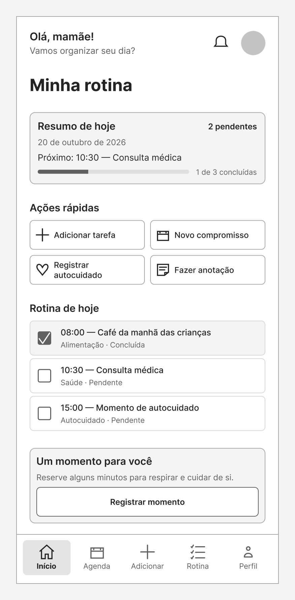

# Mãe Leve Planner — Wireframe de Média Fidelidade

Wireframe de média fidelidade desenvolvido para o desafio de projeto da Formação UX Designer da DIO.

## Sobre o projeto

O Mãe Leve Planner é uma proposta de aplicativo mobile para auxiliar mães na organização da rotina, reunindo tarefas, compromissos, lembretes e momentos de autocuidado em uma única interface.

Neste desafio, foi criada a tela principal “Minha rotina”, priorizando organização, clareza e facilidade de uso.

## Wireframe

## Funcionalidades representadas

- Resumo das atividades do dia;
- Visualização do próximo compromisso;
- Indicador de progresso das tarefas;
- Adição rápida de tarefas e compromissos;
- Registro de momentos de autocuidado;
- Criação de anotações;
- Lista da rotina diária;
- Identificação de atividades concluídas e pendentes;
- Navegação inferior entre as áreas do aplicativo.

## Decisões de usabilidade

A interface foi organizada com foco na redução da carga cognitiva e na facilidade de reconhecimento das ações.

Foram aplicados os seguintes princípios:

- Hierarquia visual clara;
- Agrupamento de informações relacionadas;
- Textos e rótulos objetivos;
- Consistência entre botões, cards e ícones;
- Feedback visual para atividades concluídas;
- Navegação simples e previsível;
- Elementos com áreas adequadas para interação;
- Contraste entre conteúdos principais e secundários;
- Design minimalista.

## Heurísticas de Nielsen aplicadas

- **Visibilidade do estado do sistema:** indicação das tarefas concluídas, pendentes e do progresso diário;
- **Consistência e padrões:** repetição dos estilos de cards, botões, ícones e textos;
- **Reconhecimento em vez de memorização:** ações acompanhadas por ícones e rótulos;
- **Prevenção de erros:** controles visuais claros para marcar atividades;
- **Design estético e minimalista:** apresentação somente das informações necessárias;
- **Controle e liberdade do usuário:** acesso direto às principais ações e áreas do aplicativo.

## Protótipo no Figma

Acesse o arquivo editável:

[Mãe Leve Planner — Wireframe DIO](https://www.figma.com/design/ljBWF5bIxgbkVPZCY0INf5/M%C3%A3e-Leve-Planner-%E2%80%94-Wireframe-DIO?node-id=0-1&t=8ajcNRpeiCrAvphN-1)

## Ferramentas utilizadas

- Figma;
- GitHub;
- Conceitos de UX Design;
- Heurísticas de Nielsen;
- Princípios de usabilidade.

## Desafio

Projeto desenvolvido como parte do desafio **Criando um Wireframe de Média Fidelidade**, da Formação UX Designer da DIO.

## Autoria

Desenvolvido por [Josely da Silva Lima](https://github.com/joselysilva-dev).
